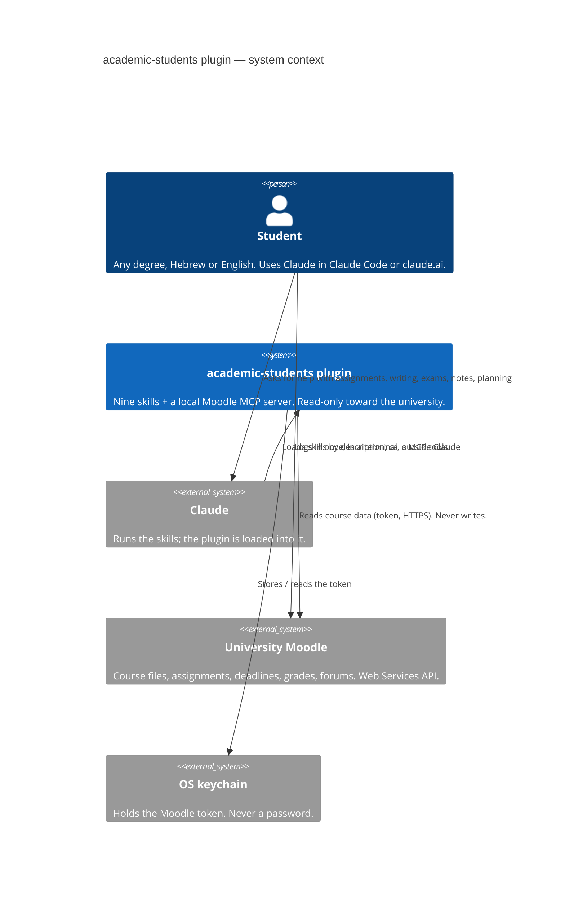
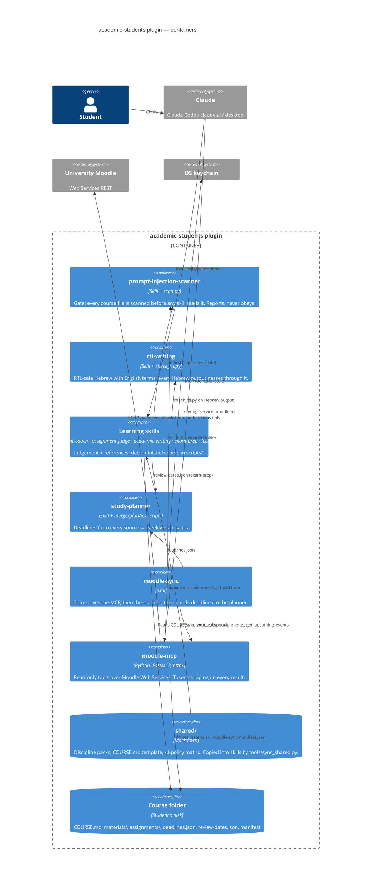

# Architecture — C4 views

Framework: **C4 model**, rendered as Mermaid so it displays on GitHub. Two views are enough here: the
System Context (who talks to what) and the Container view (what runs where). Element IDs follow
`ea:noam:academic-students:<kind>:<name>` and are reused by the ADRs in `decisions/`.

## Level 1 — System Context

What the plugin is, who uses it, and the three external systems it touches. For everyone.

IDs: `ea:noam:academic-students:person:student`, `…:system:plugin`, `…:external:claude`,
`…:external:moodle`, `…:external:keychain`.

## Level 2 — Containers

The runnable/deployable pieces inside the plugin, and the files they exchange. For contributors.

IDs: `…:container:scanner`, `…:container:hebrew`, `…:container:learning-skills`, `…:container:study-planner`,
`…:container:moodle-sync`, `…:container:moodle-mcp`, `…:container:shared`, `…:container:course-folder`.

## Reading the diagram

- Two containers are **cross-cutting**: the scanner (every inbound file) and rtl-writing (every
  Hebrew output). Every other skill depends on both; neither depends on anything.
- Skills compose through **files with pinned shapes** (`deadlines.json`, `review-dates.json`, `slides.json`…),
  not through prose. The shapes are in the plans and the tests.
- The MCP server is the only container that talks to the network, and it only talks to Moodle. Its function
  allowlist is a test (`servers/moodle-mcp/tests/test_server_tools.py`).
- `shared/` is a build-time dependency, not a runtime one: skill folders are self-contained after the sync so
  each can be uploaded to claude.ai alone.

## Deployment note

| Surface | Skills | MCP server |
|---|---|---|
| Claude Code | all | yes (`.mcp.json`, `uv run`) |
| Claude desktop app | all | yes |
| claude.ai chat | all | no — `moodle-sync` falls back to a course zip / `.ics` the student uploads |

Decisions behind this shape: [ADR-0001](decisions/ADR-0001-merge-helper-and-solver.md),
[ADR-0002](decisions/ADR-0002-moodle-read-only-mcp.md),
[ADR-0003](decisions/ADR-0003-shared-packs-copied-not-linked.md),
[ADR-0004](decisions/ADR-0004-no-password-storage.md).
